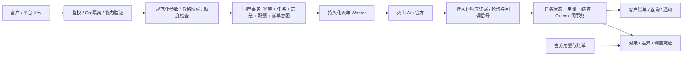

# 火山 Ark / Seedance 2.0、2.5 官方视频网关方案

> 评审稿，2026-10-15（北京时间）。本次交付为方案、接口契约和数据设计；**尚未修改运行代码、执行数据库迁移或完成新增能力的真实付费验收**。
> 本文区分：① PDF 提出的业务边界；②当前仓库已有实现；③官方公开契约；④本平台拟议设计。本文为待实施专项方案，不把目标能力登记为《整体架构设计.md》中的已实现事实。实施前需将批准的决策合入该架构事实源。

配套文件：[OpenAPI 3.1 契约](api/seedance-v1.openapi.yaml)、[数据与账务设计](火山Ark视频网关-数据与账务设计.md)。文中接口示例是平台设计示例，不是火山真机响应。

## 1. 方案结论与第六条落实

采用 PDF 第六条方式 D：**客户 → 我方 Key/域名 → 统一鉴权及额度冻结 → 我方 Ark 适配器 → 火山官方 → 官方任务用量 → 我方账本 → 供应商账单核对**。复用现有组织、Key、渠道凭证、ledger 和 task 模块，不再建设独立余额系统。

客户调用的任务、素材、素材组编号都是平台编号。上游 API Key、AK/SK、账号、项目、接入点、任务编号、素材编号、合同折扣只在内部映射。对外保留 Ark 的内容结构和参数含义，但必须经过鉴权、能力验证、资源归属检查和计费快照，不能提供任意 URL/Action/凭证的代理。

| PDF 边界 | 本平台落实 | 不得作出的承诺 |
|---|---|---|
| §6.1 官方 Key 不出网关 | 下游平台 Key；推理凭证和管理凭证分别保管；仅服务端注入 | 不向客户发官方 Key、AK/SK；错误和日志不能泄露凭证 |
| §6.2 请求前额度校验 | 同事务预留组织钱包、Key/日/月金额与 Token 配额；失败不派单 | RPM、预算告警不能充当余额硬拦截 |
| §6.2 按 usage 结算 | 官方 `completion_tokens` × 创建时锁定的销售价格；估算只供冻结 | 不把估算、HTTP 200 或视频时长当最终 Token |
| §6.3 熔断和对账 | 请求级额度闸、供应商成本预算、官方用量/账单核对、差异工单 | 停新请求不等于停止已经运行的视频 |
| §6.4/§9 商务和内容边界 | 转售及服务地区授权、真人授权、内容审核作为生产准入条件 | 技术代理不能自动取得转售、肖像或跨地区许可 |
| §4/§8 分层防护 | 在账号实际支持时配置项目/接入点/模型限额及余额预警 | Key/项目不是独立资金池；不能假设所有 Seedance SKU 支持相同限额能力 |

PDF 共 19 页，重点核对第 10–12 页第六条及第 18 页边界。PDF 中的控制台操作和外链是参考材料，本次未据此修改任何火山账户设置。

**“严格控制”分两层**：客户钱包和配额在本平台可做到原子预留、不超授权扣款；火山侧最终成本存在异步执行、估算偏差、账单延迟和运行中不可取消的风险。金额实扣硬上限与 Token 预留准入限额分别定义：只有能证明单任务 Token 上界的规格，才能承诺真实 Token 绝不越限；其他规格必须披露估算误差和超额停单机制。必须设置供应商在途成本预算与风险准备金，不能把一个估算系数称为官方绝对上限。

客户隔离默认采用“一下游客户一 Org”；一个客户可以有多把 Key。现有任务是 Org 级共享，不能把同一 Org 下不同 Key 默认视为互相隔离的不同客户。若销售需要一个 Org 托管多个客户，应先新增 `client_id` 资源边界和全链路权限，再开放该模式。

## 2. 当前仓库：可复用基础与必改缺口

以下行号按本次读取的工作区定位，后续修改后可能变化。

| 现状 | 代码位置 | 处理 |
|---|---|---|
| 已有创建、单任务查询和内容代理三个路由 | `core/internal/server/server.go:338` | 保留主路径，扩展列表、取消、删除和素材接口 |
| Ark POST/GET 与 Bearer 构造已存在 | `core/internal/task/volcengine.go:217,293` | 复用协议客户端；官方渠道与第三方兼容渠道必须有独立配置标识 |
| 已有任务价格/倍率和凭证 ID 快照、CAS 结算 | `core/internal/task/task.go:191,219,667` | 保留；增加模型版本、场景价格、供应商归属和使用量快照 |
| 网络失败/解析失败会换渠道重试创建 | `task.go:294–310` | P0：结果未知不得自动再次生成 |
| 上游 ID 回填失败仍返回普通成功 | `task.go:335–341` | P0：durable intent/attempt + 异常恢复，不能丢失已受理任务 |
| 本地 30 分钟清扫直接失败退款 | `task.go:38,517,824` | P0：改为观测超时和待核对，不凭年龄退款 |
| Key quota 是可超一笔的软预算，预留/调整不在主事务 | `identity/apikey.go:188–202`；`task.go:211,697` | P0：改成同事务原子 reservation，不再 best-effort 退补 |
| 估算只看固定像素、duration/fps，忽略模型、输入视频、frames | `volcengine.go:166–214` | P0：版本化规格及计量规则；取消 4M 人工截顶 |
| usage 缺失按估算收费；超过冻结截金额 | `task.go:649–674` | Ark 缺用量进入待补量；保留真实用量与平台承担差额 |
| 任务未使用渠道模型映射 | `volcengine.go:225` | 创建快照 public model → 官方 model/endpoint；后续不可漂移 |
| `cancelled` 被并入 `failed` | `volcengine.go:341` | 独立取消状态；增加官方 expired；保持原始状态证据 |
| 只有终态 Invocation；内存队列满/写失败丢记录 | `task.go:749`；`invocation/invocation.go:124,163` | P0：请求/attempt/event 持久化；投影视图可异步，权威证据不可丢 |
| payload 指针为空，加密全量留存未实现 | `docs/整体架构设计.md:374` | 实现 Invocation Store 的加密原文层后，才宣传完整请求回看 |
| 素材域和真人认证链路未实现 | `core/internal/task`、server 和 migrations 检查 | 新建资源映射与授权域，不能仅加转发路由 |

已有 2026-07-05 的 Seedance 2.0 真机 fixture，可作为历史基础；其 4 秒/720p 成功样本不能证明 2.5、当前全部价格档位、视频输入、真人素材和取消竞态均已验证。

## 3. 官方契约核验与能力版本

### 3.1 两个官方服务面

| 用途 | 上游入口 | 鉴权 | 本平台处理 |
|---|---|---|---|
| 视频创建/查询/列表/取消删除 | `https://ark.cn-beijing.volces.com/api/v3/contents/generations/tasks` | Ark API Key Bearer | 固定任务提交时的账户、区域、项目、渠道及凭证版本 |
| 素材、真人认证、用量查询/导出 | `https://ark.cn-beijing.volcengineapi.com/?Action=…&Version=2024-01-01` | AK/SK HMAC-SHA256，service=ark，region=cn-beijing | 使用独立最小权限服务身份与官方签名 SDK；不接收客户 Action/Version |

默认只接中国大陆 Ark 按量推理入口。BytePlus ModelArk、第三方兼容网关及 `/api/plan/v3` 套餐入口是不同产品，不共享价格规则、授权判断和故障转移池。

### 3.2 模型映射和能力开关

| 我方模型名 | 本次核对的官方 Model ID | 输出时长范围 | 本方案需要分别核验的价格档 |
|---|---|---|---|
| `seedance-2.0` | `doubao-seedance-2-0-260128` | 4–15 秒，或 -1 自适应 | 480p/720p、1080p、4k；每档区分有无视频输入 |
| `seedance-2.5` | `doubao-seedance-2-5-260628` | 4–30 秒，或 -1 自适应 | 480p/720p、1080p；不能由 2.0 推断支持 4k |

这是文档核对结果，账号可用性仍需在指定官方账号验证。[官方模型对照](https://docs.volcengine.com/docs/ark/video-generation-tutorial?lang=en)、[Seedance 2.5 教程](https://docs.volcengine.com/docs/ark/seedance-2-5?lang=zh)。

建立不可变 `capability_version`：记录模型版本、允许任务类型、内容项与数量、输入媒体范围、分辨率/比例/帧数规则、默认参数、支持的素材类型、价格版本、验证证据和 `enabled`。`GET /v1/video/models` 只向客户公布其有权限且已启用的能力。未知模型/参数、未定价场景和未验证能力直接拒绝，不能静默删参数或猜价后派单。

2.5 的编辑模式要求参考视频，`ratio=adaptive`、`duration=-1`；首帧/首尾帧以及延长模式也存在比例约束。`frames` 与 `duration` 的优先级必须按官方规则处理；我方新接口选择二者同时出现即 422，避免用户误判。实际返回的整数 `duration` 可能是帧数折算后向下取整，不能反推精确账单。能力验证依据[官方创建 API](https://docs.volcengine.com/docs/ark/create-video-generation-task-api?lang=zh)。

首期默认只开放已完成真机验证且可可靠冻结的普通生成场景。2.5 编辑、延长、Draft、4k、外部视频引用可以逐项启用；完整设计保留这些场景，不能在尚未验证时将它们显示为“已上线”。联网搜索、版权 IP、未知增值工具若没有独立费用规则则拒绝，不能只收视频 Token 却忽略额外费用。

### 3.3 对参考平台的使用范围

已阅读可访问的 [AI-TokenHub 创建任务页](https://docs.ai-tokenhub.ai/zh/api-guides/Create-video-generation-task) 与检索到的 [英文能力页](https://docs.ai-tokenhub.ai/en/api-guides/Dreamina-Seedance-2.0)。用户指定中文能力页本次直接抓取失败，因此没有声称完整验证该页。

借鉴其 Ark 风格 `content` 数组、异步任务与素材引用体验。它使用 `/api/v2/contents/generations/tasks`、自有模型名和 `submitted/upstreamTaskId` 等平台字段；这些不作为火山官方契约。本平台隐藏上游 ID，用自己的 task ID 和 request ID 提供售后定位，并沿用仓库已有 `/v1/video/generations` 主路由。

另外核对了其[素材接口页](https://docs.ai-tokenhub.ai/en/api-guides/Resource-library-interface-documentation)：该平台自行采用 Bearer `pak:psk`、忽略 ProjectName，并对素材创建和真人响应封装作了转换。本方案不沿用这些自定义行为；对接官方仍使用 HMAC、项目一致性及异步素材状态查询。

## 4. 目标处理链路



所有外部副作用前先写持久化 intent。DB 事务不能跨 HTTP 请求长期持锁；任务队列是事务 outbox 的投影，不能成为唯一保存任务的地方。worker 用租约、版本号和 fencing token 防并发领取；派单开始一旦进入可能已发送状态，worker 崩溃后不能仅凭租约过期再次 POST。

提交返回 202 表示平台已接受并可靠冻结，不保证上游已经受理。保存 `accepted_at`、`upstream_submitted_at`、`last_synced_at`，客户端通过 GET 查询。上游任务只有经过请求证据和归属验证后才绑定；不开放“传任意 cgt ID 导入任务”。

## 5. 我方对外接口

完整字段、响应码和 `$ref` 以配套 OpenAPI 评审稿为准；以下定义业务语义。所有客户路由统一平台 Bearer Key，权限至少区分 `video:create/read/cancel/delete`、`assets:read/write`、`portrait:authorize`、`billing:read`。

### 5.1 接口清单

| 方法与路径 | 行为 | 上游映射 |
|---|---|---|
| `GET /v1/video/models` | 可用模型、能力及公开价格版本 | 本地配置 |
| `POST /v1/video/estimates` | 估算 Token/冻结金额，不创建任务、不占额 | 本地计量规则 |
| `POST /v1/video/generations` | 幂等创建任务，202 | POST 官方任务 |
| `GET /v1/video/generations` | 本客户任务分页及筛选 | 本地库，禁止直接返回账号上游任务列表 |
| `GET /v1/video/generations/{task_id}` | 本地权威状态、用量、账务与同步状态 | 后台固定凭证 GET |
| `POST /v1/video/generations/{task_id}/cancel` | 请求取消，202；不保证取消成功 | 有条件调用官方 DELETE |
| `DELETE /v1/video/generations/{task_id}` | 终态记录和产物可见性删除，202/204 | 符合官方状态时 DELETE |
| `GET /v1/video/generations/{task_id}/content` | 鉴权后读取托管产物 | 受控下载/对象存储 |
| `GET /v1/video/generations/{task_id}/billing` | 客户冻结、实扣、释放、调整及计量依据 | 我方账本 |
| `GET /v1/video/generations/{task_id}/events` | 脱敏后的任务事件时间线 | 本地事件投影 |
| `GET /v1/video/operations/{operation_id}` | 取消/删除操作的独立进度与结论 | 本地操作记录；删资源后仍可查 |
| `POST/GET /v1/video/asset-groups` | 创建虚拟组/列表 | CreateAssetGroup；本地租户列表 |
| `GET/DELETE /v1/video/asset-groups/{group_id}` | 查询/受限删除组 | GetAssetGroup/DeleteAssetGroup |
| `POST/GET /v1/video/assets` | 导入素材/列表 | CreateAsset；本地租户列表 |
| `GET/DELETE /v1/video/assets/{asset_id}` | 查询/删除素材 | GetAsset/DeleteAsset |
| `POST/GET /v1/video/portrait-authorizations` | 发起真人 H5 认证/查询不含认证链接的会话摘要列表 | CreateVisualValidateSession/本地授权会话 |
| `GET /v1/video/portrait-authorizations/{session_id}` | 查询认证与平台 group_id | GetVisualValidateResult |

所有 GET 的 Org 谓词在 repository 强制；不存在与无权访问统一返回 404。客户账单和事件 DTO 采用字段白名单，不能序列化内部 task/channel/bill ORM 对象。

### 5.2 创建请求与参数控制

```http
POST /v1/video/generations
Authorization: Bearer <PLATFORM_API_KEY>
Idempotency-Key: order-20261015-video-001
Content-Type: application/json
```

```json
{
  "model": "seedance-2.0",
  "content": [
    {"type": "text", "text": "镜头缓慢拉远，展示雨后的城市街道"}
  ],
  "resolution": "720p",
  "ratio": "16:9",
  "duration": 5,
  "generate_audio": true,
  "watermark": true
}
```

设计上的处理规则：

- 下游请求只接受平台模型名和平台资源编号，平台转换到任务绑定的官方资源；`safety_identifier` 由平台生成，不信任客户用于身份声明。
- 将有效默认值写进规范化请求，计价和实际发送必须使用同一份 effective request。不能依赖可能变化的上游默认时长/分辨率。
- 可携带我方 `max_charge_usd` 与 `expected_pricing_version`，限制本次允许冻结的金额和可接受销售价格版本；不一致则 409，二者不发给火山。省略时仍不能绕过组织/Key 钱包与预算限制。
- 新接口不接受提示词内的旧式计价参数指令。检测 `--dur/--duration/--rs/--resolution/--frames` 等官方参数语法及规范化变体，有歧义则拒绝并提示使用结构化字段；不能按 5 秒冻结却让提示词指定 30 秒。
- `content.image_url/video_url/audio_url.url` 的 `asset://asset_…` 是我方资源引用，先验证 Org、状态、类型、授权、账号/区域/项目一致，再转换为官方 `asset://…`。客户直传官方素材编号拒绝。
- `draft_task.id` 同样只能引用本客户的我方 task ID，验证已成功、可用期、原模型/项目/账号以及原视频输入计费上下文。
- 不直接转发客户端 Authorization、Host、callback_url、ProjectName、上游 endpoint 或任意额外参数。平台自有字段在出站前移除。
- JSON 大小先沿用仓库 10MiB 上限，媒体用受控 HTTPS URL/素材引用；不承诺与上游所有 Base64 上限一致。超限 413，未知字段及不支持组合 422。

创建返回一个平台任务对象（例如 `id=task_…`、`status=accepted`），包含创建时间、model、billing 状态和同步状态。用量尚未取得时为 `null`，不能用 0 暗示没有消耗。

### 5.3 幂等与错误

`Idempotency-Key` 对创建任务、创建素材/组、真人会话和取消操作必填。使用 `(org_id, method, canonical_operation, key_hmac)` 唯一约束，跨同客户 Gateway Key 轮换有效；`canonical_operation` 含实际目标资源 ID。幂等键与规范化请求分别计算服务端 HMAC-SHA256，使用不同域标签并保存密钥版本。相同键相同请求返回同资源/操作，不能再冻结或发 POST；相同键不同请求返回 409。不同 URL 别名必须归一到同一 operation，不能借兼容路由绕过去重。

首次规范化/价格/能力版本必须保留；之后重放先定位既有幂等记录，不因默认值或价格版本更新误判同一请求。HMAC 轮换须查重所有仍保留的旧版本；多实例仅使用一个生效写版本，并共享轮换闸门和跨版本串行化规则，避免滚动发布时重复受理。幂等键不因任务删除重用，保留期至少覆盖任务恢复/争议窗口；过期不确定重放应拒绝并要求新业务单号，不能悄悄重发历史任务。

错误 envelope 统一含 `error.code/message/retryable` 和我方 `request_id`。约定：400 请求格式错误；401 Key 无效；403 模型/操作未授权；402 余额或金额额度不足；404 资源不可见；409 幂等冲突/状态冲突；410 产物已过期；413 请求过大；422 参数/能力未支持；429 Token 配额/RPM/并发受限；502 上游明确失败；503 存储或上游暂不可用。`retryable` 仅说明是否可用**同一幂等键**重查/重试，不表示可以重新生成。

官方错误原文保存在受控 Invocation Store，客户端只得到安全错误码、字段路径和脱敏说明。不得原样回传可能含账号、官方 Key、素材签名 URL 或提示词的 message。

### 5.4 取消与删除的边界

| 状态 | 我方 cancel | 我方 delete | 资金处理 |
|---|---|---|---|
| accepted，尚未派单 | 同事务关闭待派单 intent，确认后 cancelled | 409 | 确认未发送后释放 |
| submitting / submission_unknown | 记录取消意愿，202，等待查明 | 409 | 保留冻结，不重发 |
| queued | 调官方 DELETE，202，等待证据 | 409，请先取消 | 确认取消后释放 |
| running | 409 `invalid_state` | 409 | 继续观察和结算 |
| succeeded | 409 | 已结算且证据持久化后可删除 | 不退款 |
| failed / expired | 已终止，返回明确状态 | 资金落定后可删除 | 依据官方终态与费用证据释放/核对 |
| cancelled | 幂等返回已取消 | 我方可软删；不对官方重复 DELETE | 不重复释放 |

官方 DELETE 对 queued 是取消，对 succeeded/failed/expired 是删除记录；running 和 cancelled 不支持。[官方取消或删除 API](https://docs.volcengine.com/docs/ark/cancel-or-delete-video-generation-tasks-api?lang=zh)。

取消 POST 和上游 DELETE 超时都只能记录 `operation=unknown`。特别注意不可消除的竞态：查询时 queued，DELETE 到达时任务可能已 succeeded，此时官方 HTTP 200 可能表示**删除刚完成的记录**，不是取消；随后 GET 404 也不能补证。只有持久化的 cancelled 状态或其他足以证明未计费取消的官方证据才允许释放；200+404 而缺少该证据时转 unknown/pending_usage，尝试用量明细、账单或工单恢复。不能声称取消通道绝不会销毁上游查询入口。

操作状态独立保存 `pending/in_flight/unknown/confirmed/rejected`，客户端通过 `/v1/video/operations/{operation_id}` 查询，资源删除后的 404 不承担操作确认含义。已明确成功的同一删除操作可重放 204；其他情形应先查本地证据，不能把任意 404 转成退款。

对外删除以 `deleted_at` 隐藏任务，清理我方产物需独立可重试操作。账本、规范化用量和必要财务审计不随业务删除级联清除。**主动删除终态记录**须先完成结算及证据持久化；未结算/缺用量/对账争议时拒绝。排队取消复用 DELETE 的特殊竞态按上一段处理，不能套用“必定安全删除”的假设。

### 5.5 兼容旧调用方式

保留已有 `/v1/video/generations` 路径和旧响应所需字段，通过明确的接口版本/客户能力开关切换新语义；不能原地把既有客户的 200 响应无通知改为 202。旧路径同样必须使用新的安全状态机和资金闸，不保留“超时退款”等漏洞。

可另提供 Ark SDK 兼容路由 `/api/v3/contents/generations/tasks` 的薄包装，共用业务服务。它的字段/状态兼容程度需另行声明：本平台的 `accepted/submission_unknown` 与官方不完全相同，不能宣传零差异兼容。首期 OpenAPI 只定义平台主接口，避免维护两套账本或两套任务。

## 6. Token 计量、定价与冻结

### 6.1 官方计量与价格快照

```text
基础估算 T_formula = (D_input_video + D_output) × W_output × H_output × FPS_output / 1024
含视频预估 T_est = max(T_formula, 当前模型/规格的最低 Token 规则)
最终计费用量 T_actual = 官方任务 usage.completion_tokens
单项金额 = T_actual / 1,000,000 × 对应场景每百万 Token 单价
```

公式服务于预估，实际 usage 已表达官方计费用量，最终结算不能再对其重复叠加最低 Token。输入图片/音频不等于“含视频”；参考视频要计入输入时长。最低 Token 规则必须导入版本化表/官方计算器验证，不能统一猜成一个常数。[官方价格与计量](https://docs.volcengine.com/docs/ark/model-pricing?lang=zh&redirect=1)、[查询返回用量定义](https://docs.volcengine.com/docs/ark/list-video-generation-tasks-api?lang=zh)。

以下为核对日官方刊例价，单位 **CNY/百万 Token**，不是客户售价或合同净成本：

| 模型 | 输出分辨率 | 无输入视频 | 有输入视频 |
|---|---|---:|---:|
| Seedance 2.0 | 480p / 720p | 46 | 28 |
| Seedance 2.0 | 1080p | 51 | 31 |
| Seedance 2.0 | 4k | 26 | 16 |
| Seedance 2.5 | 480p / 720p | 70 | 42 |
| Seedance 2.5 | 1080p | 77 | 46 |

[官方资源包价目与场景表](https://docs.volcengine.com/docs/ark/seedance-2-0-model-resource-pack-rules?lang=zh)可交叉核验单价维度，但资源包抵扣额度、现金成本与原始视频 Token 必须分别记账，不能直接混为一列。任何合同价、促销价和资源包抵扣要有生效期与证据；不能自动套用已过期的 fast/mini 促销。

销售价格采用单独的 USD/百万 Token 规则，以保持当前美元账本。金额使用 `shopspring/decimal`、`DECIMAL(20,8)`；Token 为 BIGINT；禁止 float 算钱。创建时冻结销售价格、折扣/组倍率、规则版本；供应商 CNY 刊例/合同估计、汇率方向及版本单独冻结。客户不读取供应商成本和利润。

汇率统一定义为 `fx_usd_per_cny`，即 1 CNY 可换多少 USD：供应商成本折美元 = CNY 成本 × 汇率；不把人民币数值直接写入 `output_usd_per_1m`。USD 销售价格已确定时，不因官方账单晚到或汇率变动重算历史客户售价。各金额统一八位小数，冻结向上取整，结算使用约定舍入方式并记录版本；展示两位小数不影响内部精度。

### 6.2 可复算示例

以 720p、16:9、1280×720、24fps、输出 5 秒、无输入视频为例，公式估算为 108,000 Token。官方刊例估算：2.0 为 4.968 元，2.5 为 7.56 元。此例只解释算法，不代表最终调用一定返回该用量。

若某次成功任务实际返回 108,900 Token，按 2.0 的上述刊例档计算供应商标价为 5.0094 元。假设平台**示例销售价**为 8 USD/百万 Token、倍率为 1，则客户应计费 0.8712 USD；若此前冻结 1.04 USD，结算释放 0.1688 USD。示例销售价不是本次批准的商业报价。

4k 输入视频 15 秒 + 输出 15 秒，按 3840×2160、24fps 的基础公式已经达到 5,832,000 Token；因此现有固定 4M 截顶会低估。若平台允许该场景，应提高合法冻结范围或拒绝请求，不能把预估硬截为 4M 后照常提交。

### 6.3 保守冻结的落地方法

1. 校验并规范化全部计价输入：模型、任务类型、分辨率/比例、frames 或 duration、参考视频、Draft 父任务、增值项。
2. 得到输入视频时长的可信上界。优先使用平台已入库的不可变素材元数据；任意外部 URL 不能依赖客户自报时长。可转存后探测，或按模型允许的最大总输入时长冻结。外部 URL 可变时禁止使用一次探测值作为硬上界。
3. 计算输出上界。`duration=-1` 按该模型/模式最大合法输出，2.5 编辑按受验证输入及官方限制；`adaptive` 按允许比例的最大像素范围；frames 按合法帧数和官方 fps 规则。未验证的尺寸映射不能假装精确。
4. 取基础估算与最低 Token 上界的较大值，再加**平台风险余量**。现有 1.3 不是官方计费系数，也不能称为“音轨附加费”。余量按真实样本覆盖率迭代并保存版本。
5. 同时冻结客户销售额和供应商预算中的预计成本敞口。无法为该能力给出可靠上界、价格或风险容忍范围时，拒绝并给出可支持规格。

预览估价不锁价不占额；创建时重新验证并锁定。若价格/能力版本改变导致所需冻结超出客户已声明的允许范围，应明确报冲突，不能静默提高扣款。

**原子金额/Token 日月准入**：事务内检查 `consumed + reserved + this_reservation <= limit`，再增加 reservation；不能只检查 `used < limit`。不同 bucket 固定排序加锁，组织钱包/Key/日/月/模型及供应商预算一起成功或一起回滚。跨日/月任务仍消耗创建时的预算 bucket，报表另记完成时间；在途敞口不随跨月消失。金额实扣还受授权冻结上限保护；Token 实际值如果超过估算，必须保真记为超额并阻断新受理，不能靠截断统计掩盖，也不能把准入检查称为绝对 Token 封顶。

### 6.4 最终结算及异常

| 情况 | 用量/客户资金 | 供应商成本 |
|---|---|---|
| 官方 succeeded，usage 完整且可信 | 同事务 CAS + exact settlement；释放差额 | 记录 usage 估算成本，等待官方账单 |
| 官方 succeeded，usage 缺失/畸形 | `pending_usage`，保留冻结；查询/导出补量，不能以估算实扣 | 标 pending，不填零成本 |
| 确认官方失败/取消，且计费规则无费用 | release 一次；保存证据 | 独立等账核对异常收费 |
| 上游 expired | 保存官方终态，按确认的计费规则处理；不能由本地倒计时制造 expired | 账单冲突进入差异单 |
| 提交超时/未知/404/查询鉴权失败 | 不自动重发、不自动释放；待核对 | 保留在途风险预算 |
| 实际应收超过冻结 | 保留完整真实 Token、理论应收和超额；默认客户实扣不超冻结，差额记平台承担 | 全额记真实供应商责任并熔断问题规格 |
| 已结算后官方成本更正 | 客户账不自动改变；如需客户纠错必须按合同有独立调整规则 | 追加成本调整凭证，不覆盖历史 |

客户无透支授权时不能补扣到负余额。若未来允许追加冻结/授信，需要单独客户授权与原子余额校验，不能仅修改 `cost_usd`。Token 统计必须保留真实用量，即使超出预留也不能截短；发生超限后阻断新任务并记录风险差异。

Draft 必须两笔任务、两份冻结和两次结算；正式片引用父 Draft 的原视频输入场景/时长，而不是把 Draft 自身再次当参考视频累加。父任务归属、模型、价格分支和原输入信息都要保存，不能只存父 task ID。规则见[官方 Draft 说明](https://docs.volcengine.com/docs/ark/seedance-2-5?lang=en)及价格页。

当前官方 2.5 正式片转换要求：content 仅引用 draft_task，resolution=1080p；时长、比例、seed、generate_audio、原输入和 `omni_reference_task_type` 由父任务继承，客户端再次传入应拒绝。watermark/output_format/return_last_frame 等可重新指定的字段按官方规则处理，省略并不表示继承父值。平台用于计价的 effective context 可以包含继承结果，但发送的 JSON 不得重新注入官方禁止传入的继承字段。

## 7. 任务状态、恢复与回调

任务主线：`accepted → submitting → queued → running → succeeded/failed/expired`；取消分支为 `accepted(确认未发送) → cancelled` 或 `queued(官方确证) → cancelled`，不允许从 running 凭本地意愿改成 cancelled。`submitting` 可能转为 `submission_unknown`，只能凭确证恢复到对应状态。官方原始状态另存，不把陌生状态永久伪装为 running。

账务状态：`reserved / pending_usage / settled / released / adjusted`；同步状态：`fresh / stale / needs_review`。取消/删除操作另有 pending/in_flight/unknown/confirmed/rejected 状态。这样“视频已成功但账单待补量”可准确表示，不必将它误报失败。

恢复规则：

- **确定未发送**（如连接前失败）可安全重试；明确官方拒绝可按分类处理。POST 已写出、5xx、读取超时、2xx 缺 ID 都按潜在受理处理。未核实官方创建幂等支持前，不假设透传一个 Idempotency-Key 就能避免双生成。
- 已发送但未记录 ID：保留 attempt、官方 RequestId、提交时间窗、模型和凭证归属，通过官方记录/账单支持排查。按时间/提示词相似匹配只能作为候选，不能自动认领或重扣客户。
- 30 分钟等本地观察阈值只触发告警/加速对账。任务执行期限依据保存的 effective request 及上游实际状态，不能提前全退。
- 两阶段完成：先记录 generation outcome 和原始用量证据；再以幂等结算键写账。CAS、journal、quota、event 和 notify outbox 同事务，重复轮询不会重复扣款。
- 对未解决任务设置升级期限和责任人，持续占用敞口。长期不能证明费用时可由运营作有审计的“平台承担并释放客户冻结”，同时保留供应商应付风险；不能自动假装零成本或无限期无人处理。

上游回调只到固定平台地址；在未核实官方验签能力前，回调只是唤醒轮询的信号，以固定凭证 GET 的结果确认终态。不能把客户端 callback_url 直传给上游导致绕过状态/审计。对客户通知复用现有 notify outbox，带 `event_id`、HMAC 签名、时间戳和重放窗口，至少一次投递；失败有重试和死信状态，接收方按 event_id 去重。

轮询按官方账号/模型集中调度，按任务间隔退避并加抖动，避免每个客户 GET 都向火山打一遍。当前官方教程列有查询任务 20 QPS、列表 1 QPS、取消删除 20 QPS 的账号级限制，应配置化且服从该账号实际配额。[官方限流说明](https://docs.volcengine.com/docs/ark/seedance-2-5?lang=zh)。

## 8. 虚拟与真人素材

### 8.1 对外统一资源，内部严格分类

平台素材组 `ag_…`、素材 `asset_…`，绑定 Org、供应商账号、区域、ProjectName、上游组/素材 ID。客户不能控制 ProjectName。素材与所属组项目相同，生成所用 API Key 也必须属于同一项目；引用素材的任务必须路由到该资源所在账号/项目，不得自动换到其他供应商。

| 业务 | 平台输入 | 内部官方调用 | 必须满足 |
|---|---|---|---|
| 建虚拟组 | `kind=virtual,name,description` | CreateAssetGroup，`GroupType=AIGC` | 已完成官方要求的授权函签署及权益开通 |
| 建真人组 | 不能直接 POST `kind=real_person` | H5 流程获得 GroupId 后登记 | 认证结果由服务器确认；内部类型 real 对外映射 real_person |
| 导入素材 | `group_id,media_type,url`，可选 `name` | CreateAsset，`GroupId/AssetType/URL/ProjectName`，可选 `Name` | 类型映射 image→Image/video→Video/audio→Audio；所属与权限正确 |
| 查询素材 | 平台 asset_id | GetAsset | Processing→processing；Active→ready；Failed→failed；读 Error 不能只看 HTTP 200 |
| 引用素材 | `asset://asset_…` | 内部改写为官方引用 | ready，未删，权限/授权未过期，类型与任务场景相容 |

CreateAsset 是公网 URL 异步导入，不是二进制上传接口，也不接受 Base64；本平台可以后续另建自有上传服务，但不发明“火山 CreateUpload”能力。[官方 CreateAsset](https://docs.volcengine.com/docs/ark/create-asset-api?lang=zh)、[GetAsset](https://docs.volcengine.com/docs/ark/get-asset-api?lang=zh)、[虚拟素材指南](https://docs.volcengine.com/docs/ark/private-virtual-avatar-library-guide-preview?lang=zh)。

素材列表以本地 Org 资源库为准，官方 ListAssets/ListAssetGroups 只用于内部同步。官方返回 12 小时 URL 不能当永久地址，平台对外使用受控资产访问策略；`LastInferenceTime` 也不能视为任务成功计费证据。

已核实 [ListAssetGroups](https://docs.volcengine.com/docs/ark/list-asset-groups-api) 要求按 AIGC/LivenessFace 过滤，官方游标不得跨账户/项目/接口。本平台游标自行签名并绑定 Org，不直接把上游全账户游标下发。`DeleteAsset` 动作已在官方指南确认，但本次其 API 页面仅返回 JS 页面壳，完整字段和错误行为尚待官方联调；因此保留我方 DELETE 契约，将该能力关闭至验收，不能拿参考平台 `Id/ProjectName` 示例冒充官方已实测。

删除素材需先核查在途任务引用；默认存在依赖返回 409，避免任务运行中素材消失。组删除默认要求为空；非空必须显式 `cascade=true` 且调用者有删除权限，并记录受影响资源快照。上游删除成功后本地留 tombstone，不删除历史任务引用与审计。

检查依赖、将资源置为 deleting、写删除 intent 必须同事务并持有资源锁；新建组内素材与新任务引用采用同一锁顺序并拒绝 deleting 资源，避免“检查为空后并发插入”。删除结果未知时保持屏障，不自动恢复可引用。素材和认证请求按官方账号集中限流，不按每租户分别放大官方配额。

### 8.2 真人 H5 授权链路

```text
POST /portrait-authorizations
  → 创建本地 session（绑定 Org/申请人/账号/项目/固定回跳）
  → 官方 CreateVisualValidateSession
  → 仅向会话 Owner 返回限时 authorization_url
  → 本人完成官方 H5 认证
  → 固定平台回跳收到信号
  → 服务端用已绑定 BytedToken 调 GetVisualValidateResult
  → 成功取得官方 GroupId
  → 映射平台 ag_…；之后才允许上传同一真人的素材
```

官方 `BytedToken` 有效 30 分钟、单次认证，H5 用后失效。平台会话先为 creating，可靠取得 H5 地址后为 pending；创建结果未知为 submission_unknown，不能盲目重建会话。后续为 succeeded/failed/expired。平台 `callback_url` 仅表示客户预登记的 HTTPS 完成页；不会原样作为官方 CallbackURL。官方回跳使用固定平台地址和绑定 state；客户端传 `resultCode=10000` 或 GroupId 不能改变认证状态。[创建 H5 会话](https://docs.volcengine.com/docs/ark/h5-create-visual-validate-session-api?lang=zh)、[查询认证结果](https://docs.volcengine.com/docs/ark/asset-group-id-get-visual-validate-result-api?lang=zh)。

BytedToken 和含临时凭据的 H5Link 只在专门的加密短期 secret store 保存，表内存 secret_ref；日志和公共事件只留会话 ID 与状态。浏览器认证不能代替业务授权范围/期限记录，H5 token 过期时间也不是肖像使用许可有效期。

另建平台许可记录：授权证据引用、授权人/对象绑定、用途范围、起止时间、审核人、撤销来源、撤销生效时间、`last_verified_at`。每次上传和生成校验该记录与可获得的官方证据；不能仅信任客户自报有效。**本次已核实的 GetAssetGroup 没有授权期限/撤销字段**，不能宣称可实时获知官方全部授权变化。对需人工/控制台核验的类型设置核验有效窗口与撤销处理 SLA；没有可信有效许可或超过核验窗口即拒绝新引用。存在官方后续状态接口时，验证后再接入自动更新。

真人组与认证人必须一致，自然人肖像素材不得伪装为 AIGC 绕过认证，符合官方要求的虚拟人脸仍可使用虚拟素材流程；跨账号授权可使用的资源不等于可用当前账户 API 管理。真人组删除还受官方授权状态限制：尤其控制台创建的组，授权有效/未开始/已接收时不能按普通组删除。[真人素材指南](https://docs.volcengine.com/docs/ark/guide-preview?lang=zh)、[删除素材组](https://docs.volcengine.com/docs/ark/delete-asset-group-api?lang=zh)。

本轮方案不把“拿到某个真人 URL”当作完成授权。授权撤销后停止新引用，已有在途任务按官方可取消能力处理，不能承诺强制停止 running。

## 9. 全面日志落库与任务账单回溯

### 9.1 关联链

```text
客户业务单号 / Idempotency-Key(HMAC)
 → 平台 request_id（每次HTTP独立）
 → task_id / asset_id / authorization_session_id
 → attempt_id / operation_id
 → upstream_request_id / upstream_task_id（内部）
 → usage_evidence_id / pricing_snapshot_id
 → hold_id / journal_id / adjustment_id
 → provider_bill_line_id / reconciliation_id
```

一个任务可以有多个客户 GET、多个上游 poll 和取消/删除操作；一个 HTTP request 不等于一个 task。不能再用 `request_id=task_id` 代替每次请求记录。

### 9.2 存储边界

| 数据 | 存储与可靠性 | 留存/权限 |
|---|---|---|
| 请求元数据 | 持久化 request log；method、标准路由、Org/Key ID、request/trace ID、开始结束、状态、安全错误码、duration、资源 ID | 请求记录默认 30 天；Org 只能查自己的投影 |
| 每次上游操作 | append-only attempt：操作类型、绑定渠道/凭证版本、时间、HTTP码、官方 request ID、分类结果、证据引用 | 普通运营只能看脱敏字段 |
| 生命周期 | task_event：单调 sequence、from/to、cause、operation、evidence_ref | 财务必要部分归档；不可覆盖/静默删除 |
| 请求/响应正文 | **唯一合法调用原文层 Invocation Store**：客户原文、effective request、上游响应、客户响应分别信封加密 | 默认 30 天滚动，解密必审计；Key/密码永不收录 |
| 最终计量与财务 | 规范化 usage、价格/汇率/规则快照、冻结/结算/差异、journal | 不能随 30 天调用日志清理；按财务保留策略 |
| 真人认证凭证/素材正文 | 短期 secret store / 授权素材对象；日志仅资源引用 | 最小权限与独立生命周期，避免复制生物识别原文 |

“全面落库”指所有请求和副作用的必要证据可追溯，不是将所有媒体二进制或 Key 写入数据库。财务库保存原始用量数字和计价依据，不保存 prompt、完整素材签名 URL 或人脸数据。

必须改造现有内存丢弃队列：受理、冻结、派单意图在同一个 DB 事务；请求完成及核心上游响应有持久化证据；事件到 Invocation 查询表可用 outbox 重放，唯一 event_id 防重复。DB/证据存储不可用时停止接受新付费任务并返回 503，不能先调用火山再决定是否写日志。已在途任务持续恢复与核对，不因日志投递失败退款。

为减少“外部已发生、DB 尚未写入”的不可消除窗口，发送前保存 intent，响应先持久化 inbox/加密证据，再推进状态。故障恢复把未完成记录标为 incomplete/unknown，不虚构一个成功响应。边缘鉴权失败和超大请求只记录安全元数据；未认证请求不能按其自报 org_id 写入某租户账。

现有全局架构允许 zero-retention；如客户开启，保留必要计量/财务元数据而不保存 prompt 原文，必须在客户日志中标注 `payload_retention=disabled`。只有未开启零留存且存储成功的请求才可宣称“完整原文可回看”。请求日志 30 天到期后仍能通过独立结算快照复算账单。

这里的 zero-retention 指不保存**历史回看日志原文**。可恢复异步派单仍需经客户明示接受的短期加密 execution capsule，存放于 Invocation Store 的独立执行区，禁止历史查询并在不再需要时销毁。若客户要求完全零持久化输入，则与本方案的崩溃恢复保证不兼容，应受理前拒绝该产品模式，不能暗中保留或对外承诺完全零落盘。

## 10. 官方账单回落与对账

区分三本事实：**客户销售账、供应商用量账、供应商实际费用账**。`tasks.cost_usd` 的当前含义是客户实收，不能直接改成官方成本。

### 10.1 三层核对

1. **任务级用量核对**：官方 GET 的任务 ID、模型、状态、completion_tokens 及请求证据对应到本地 task/attempt。可逐任务解释客户为什么被扣款。
2. **官方用量核对**：用 `GetInferenceUsage` 按官方 Key Resource ID、模型、时间范围核对聚合量；细查走 `CreateRecordExportTask/GetRecordExportTask`。账号/项目/Key ID 与平台客户 Key ID 必须分列。
3. **供应商账单核对**：导入费用中心真实账单，保存标价、合同折扣、优惠券、资源包抵扣、应付、退款/更正及币种。账单具备可靠 task/request ID 时精确关联；不具备时按账号/项目/Key/模型/场景/时间聚合核对，差异进入待查。

`GetInferenceUsage` 是用量接口，不是最终现金发票。其新 Key 查询须使用 Resource ID，不能传密钥本身。官方导出 API 有 3 小时时间跨度、账号活跃导出任务和每日次数限制，采用分片游标与增量重叠，不无限每任务导出。[用量查询](https://docs.volcengine.com/docs/ark/get-inference-usage-api?lang=en)、[创建明细导出](https://docs.volcengine.com/docs/ark/create-record-export-task-api?lang=en)、[查询导出结果](https://docs.volcengine.com/docs/ark/get-record-export-task-api?lang=en)。

每个账单来源保存 source_account、source_file/checksum、period、row_id、revision、下载/导入时间。账单重传不得重复入账；官方更正以新 revision/差额凭证追加，不能覆盖旧行消灭证据。只靠行内容 hash 不能吞并两笔内容相同的合法消费，需结合来源行标识与文件位置。

### 10.2 对账结果必须诚实标记

| 状态 | 含义 |
|---|---|
| `awaiting_bill` | 官方账单尚未可获取 |
| `usage_verified` | 有任务官方 usage；最终供应商现金成本未确认 |
| `bill_matched_exact` | 有可靠官方关联键与账单明细精确匹配 |
| `bill_matched_aggregate` | 只在聚合桶完成核对，不能宣称逐任务官方账单匹配 |
| `allocated_estimate` | 分摊成本，只供内部分析；不能用于强行补扣客户 |
| `mismatch` / `manual_review` | 用量、费用、归属或时段存在差异 |

按 Key 分账对后付费按量推理有适用范围；素材库等非推理费用不在同一维度中，不能用视频 Token 账自动覆盖素材服务成本。删除官方 Key 前要留 Resource ID 和历史映射；仅留 ID 不保证官方还能查询已删除 Key 的历史账单。[官方分账实践](https://docs.volcengine.com/docs/ark/practice-guidance-for-modelark-bill-split?lang=zh)。

调度建议：任务完成即补量并试结算；用量小时级增量核对；每日复拉前几天账单覆盖迟到数据；月结后锁定版本，后续更正走调整。这些是平台运维策略，不承诺火山每笔账单 T+0 可见。官方出账周期缩短也不意味着所有查询/账单接口实时可用。

客户 `/billing` 返回销售单价版本、实际 Token、冻结、实扣、释放、退款/调整、币种、账务状态和我方凭证；内部供应商成本/折扣/账号映射仅财务角色可见。客户账单最终性与供应商成本对账状态分开，供应商迟到折扣不影响已按销售合同完成的客户结算。

## 11. 产物、安全与运营

官方任务记录可查窗口为 7 天；产物 URL 通常 24 小时有效，2.5 另有下载次数限制，因此不能只保存官方直链作为永久交付。[官方查询说明](https://docs.volcengine.com/docs/ark/get-video-generation-task-api?lang=zh)。任务成功后通过受控 worker 转存一份到平台私有对象存储，记录 checksum、mime、尺寸、过期时间、转存状态；客户从平台鉴权 content 入口读取，避免轮询/重复下载耗尽上游次数。

产物转存失败与生成失败分开：保留 succeeded/账务证据，重试转存并报告 `artifact_status=pending/failed/ready`，留存期届满使用 `expired`；是否给予客户服务补偿是独立商业规则，不能因下载失败自动认定上游不收费。删除任务通过 `deleted_at` 使平台产物访问立即不可见，物理清理异步可重试，按已披露留存策略执行。

素材下载、转存、客户回调都应用 HTTPS、域名/地址校验、DNS 解析后 IP 检查、私网/metadata 拦截、重定向复检、超时/大小/内容类型限制，出站上游凭证绝不能跟随到素材域名。源 URL 的查询凭据只在受控加密层保存，错误栈不输出完整 URL。

官方凭证轮换对新任务生效；在途任务需要原账户项目的合法查询能力。禁用新建权限不能顺手删除所有在途凭证映射。凭证轮换/资源迁移需验证历史任务可查询，否则进入运维待处理，不能自动退款。

运营至少观察：未知提交数和金额、冻结龄、usage 缺失、客户额度与ledger差异、供应商敞口/准备金、任务与账单差异、轮询 lag/429、加密证据写入失败、素材认证失败/到期、产物转存失败。阈值触发优先暂停新派单，继续查询、对账、出账和恢复工作。

## 12. 实施顺序与验收

### P0：先修资金与证据链

- 引入幂等请求、durable intent、attempt/event、quota reservation 与账务 outbox。
- 切断未知提交的自动故障转移，移除本地年龄退款，处理 upstream ID 回填失败。
- 实现视频场景价格规则、计量快照、缺 usage 待结算和独立成本账。
- 将请求/轮询/操作日志改为可靠写入，完成 Invocation Store 加密正文层。

### P1：平台完整视频生命周期

- 映射公开模型名、规范化参数、能力版本和预估接口。
- 增加列表、cancel、delete、billing、events 与私有产物转存。
- 按账号配额调度轮询，接入安全回调信号与已有 notify 投递。

### P2：素材与真人

- AK/SK 管理客户端、组/素材本地映射、所有权和项目一致性检查。
- 官方 H5 认证闭环、授权状态检查和受限删除。
- 素材独立费用与容量规则、在途依赖、防重复导入与删除恢复。

### P3：供应商账单与灰度

- 用量导出、账单导入、聚合及精确对账、差异工单、调整凭证。
- 新模型/新字段逐项开启，至少覆盖 2.0/2.5 和有无视频的已启用价格档。
- 旧任务按已有快照处理，不能把新价格/新状态机推断回填为历史事实；兼容读旧记录，异常存量专项核对。

迁移只走版本化 SQL，实施时依据届时最大 migration 编号分配，禁止 AutoMigrate。现有工作区含与本方案无关的未提交修改，本次不覆盖这些内容。

### 必须通过的验收用例

| 类别 | 用例与通过标准 |
|---|---|
| 金额并发 | 同客户并发创建，钱包及所有 quota bucket 不越限；失败回滚无半冻结 |
| 幂等 | 同键并发/跨Key轮换/跨兼容路由只生成一次；不同body 409；删除后重放不重生成 |
| 未知提交 | 上游已接受后断连、2xx缺ID、DB回填失败、worker崩溃：不自动再次POST/退款，证据可找回 |
| 超时 | 超过旧30分钟后仍running或succeeded：不误失败、不停止核对、不提前全退 |
| 计价 | 2.0/2.5、分辨率、有无输入视频、最低Token、duration=-1、frames、adaptive、Draft继承逐项核对 |
| 账务 | 重复poll/回调只结算一次；缺usage不估算实扣；晚到usage可完成；actual>hold保真实用量与差额 |
| 取消删除 | queued/running竞态、取消响应超时、cancelled重复调用、成功删除不退款、未结算禁删证据 |
| 隔离 | 任务/素材/组/Draft/认证会话跨Org一律不可读写引用；同Org不同Key依产品权限共享 |
| 真人 | 伪造回跳成功无效；过期token/错误项目/非本人素材/无效授权拒绝；不能创建伪真人AIGC组 |
| 日志 | 队列满、DB恢复、outbox重复消费不丢受理记录；日志/错误无Key和payload明文；解密有审计 |
| 对账 | 账单重传/相同行内容/官方更正/迟到/只有聚合维度，均不重复扣款或伪造精确匹配 |
| 产物 | 上游URL过期、转存失败、重复下载、恶意URL、删除后的访问权限处理正确 |

真实验收使用自有授权素材和最小合法任务，捕获原始响应后脱敏制成 fixture；文档样例只能作 contract tests，不能冒充真实上游捕获。必须测试钱和状态的数据库结果，不能只断言请求构造成功。

## 13. 上线前必须落实的外部事实

1. 指定官方账户对 2.0/2.5、各规格和高级素材权益的可用性；实际项目/Key/接入点的配额与限额支持。
2. 各启用模型的最小 Token 表、尺寸规则与真实响应；现有 2.0 单样本不替代新模型验收。
3. 费用中心可获得的实际账单字段、更新延迟和逐任务关联键；没有关联键时只承诺聚合核对。
4. 客户销售 USD 单价、折扣、平台准备金和估算超额承担策略；本方案示例价格不能直接发布为商业报价。
5. 火山商业转售、客户产品、服务地区及数据处理的书面授权，特别是仓库既有全球化定位与大陆 Ark 入口的关系。当前公开专用条款含服务使用及地区限制，不能从“官方 Key 未外泄”推导已获转售授权。[平台专用条款](https://docs.volcengine.com/docs/ark/volcengine-ark-platform-terms?lang=zh)、[豆包模型服务协议](https://docs.volcengine.com/docs/ark/doubao-model-service-agreement?lang=zh)。

以上是实施/上线验收条件，不影响本次完成接口、数据和资金闭环的设计，也不表示本次已代用户签约、开通权益或修改账户。
